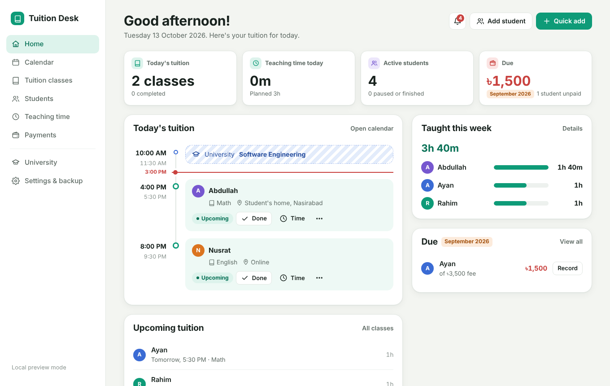
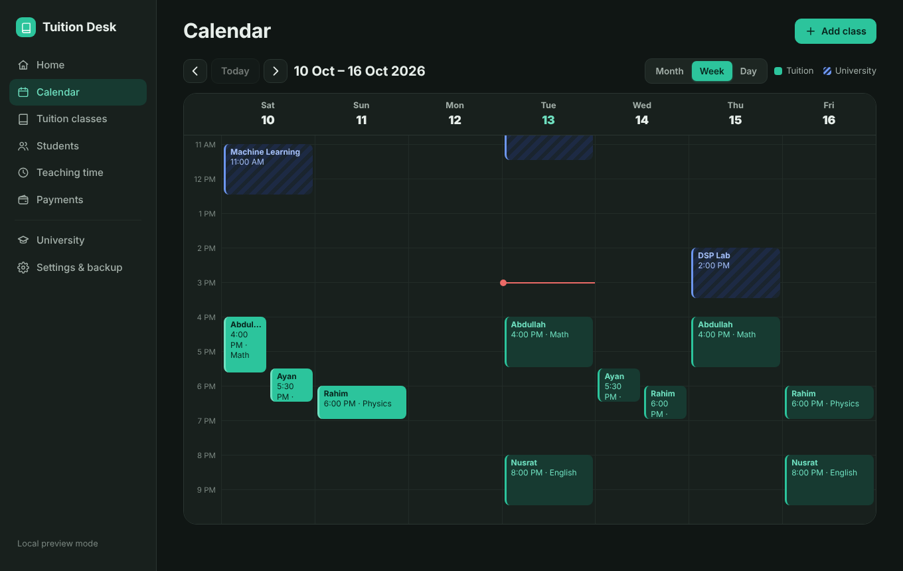
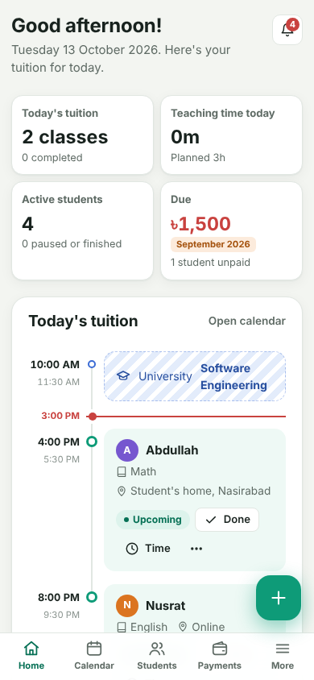

# Tuition Desk

A personal tuition management and teaching-time tracker for a university student who teaches private tuition. It manages students, weekly schedules, individual classes, the time you actually spent teaching, fees and payments, and blocks out university class times so you can see when you're unavailable.



| Calendar (dark mode) | Mobile |
| --- | --- |
|  |  |

## Features

- **Dashboard:** today's tuition on a timeline with a live "now" marker, teaching time today, active students, **Due** (what is still unpaid of the previous calendar month's fees, and who owes it), upcoming classes and hours taught this week per student.
- **Students:** profile, class, subjects, guardian, location, monthly fee, status (active, paused, finished), class history, teaching time, payment history and notes.
- **Weekly schedules:** pick days, a start time and a duration, and classes appear automatically. Any single class can still be completed, cancelled, rescheduled, edited, noted or deleted. Schedule and fee changes apply *from a date*, so history is never rewritten.
- **Teaching time:** calculated automatically as end time − start time of every completed class (adjust the times if a class ran long or short). Scheduled, cancelled and rescheduled classes count nothing. Extra sessions without a class can be added. Totals by day, week, month or a custom range, per student.
- **Payments:** per-student monthly status (paid, partially paid, due), per-month fee overrides (e.g. waive a holiday month) and dues carried over from earlier months.
- **Calendar:** month, week and day views. Tuition is shown in green, university classes as hatched blue time blocks. Adding, editing, completing or deleting a class keeps your view, date and scroll position.
- **Conflict warnings:** checks overlaps with other tuition and university classes. It warns but never changes anything.
- **Backup and restore:** export everything to a JSON file and restore it later, with validation, a confirmation step and an automatic safety copy.
- **Sample data:** load Abdullah, Rahim, Nusrat and Ayan to explore, then remove them in one click.
- Responsive with a mobile bottom bar and quick-add button, light and dark themes, keyboard accessible, installable to your phone's home screen.

## Tech stack

| Part | Choice |
| --- | --- |
| Front end | Vanilla JavaScript (ES modules), no framework, built with [Vite](https://vite.dev) |
| Auth and database | [Supabase](https://supabase.com): email/password auth, PostgreSQL with row-level security, realtime sync |
| Hosting | Vercel (production deploys from `main`), GitHub Actions for CI |
| Quality | Vitest unit tests, ESLint, CI on every pull request |

## Project structure

```
├── index.html
├── public/                  manifest and app icons
├── src/
│   ├── main.js              boot, auth state, error handling
│   ├── styles.css
│   ├── lib/                 no UI code
│   │   ├── backend.js       Supabase client + local dev backend
│   │   ├── store.js         syncs in-memory state with the backend (write queue, retries)
│   │   ├── domain.js        schedules, occurrences, teaching time, payments, conflicts, reminders
│   │   ├── backup.js        backup format and validation
│   │   ├── demo.js          sample data
│   │   ├── state.js, utils.js
│   └── ui/
│       ├── shell.js         router, layout, shared components
│       ├── pages/           dashboard, calendar, classes, students, time, payments, university, settings
│       ├── forms/           student, class, teaching time, payment, university, notes
│       ├── auth.js          sign in, sign up, password reset
│       ├── modal.js, sheets.js, backup.js, events.js, icons.js
├── supabase/schema.sql      table, row-level security policies, realtime
├── tests/                   Vitest unit tests
├── scripts/                 repository safety check and smoke test
├── vercel.json              Vercel build settings and security headers
└── .github/workflows/ci.yml lint, tests, safety check, build and smoke test on every push and pull request
```

## Try it locally (no setup)

Requires Node.js 20 or newer.

```bash
npm install
npm run dev
```

Open the printed URL. Without Supabase settings, the dev server runs in **local preview mode**: no login, and data is kept only in that browser. Use it to try the app, not to store real data. Production builds never fall back to this mode.

## Set up for real use

### 1. Create the database (Supabase, free tier)

1. Create a project at [supabase.com](https://supabase.com).
2. Open **SQL Editor → New query**, paste the contents of [`supabase/schema.sql`](supabase/schema.sql) and click **Run**.
3. Open **Authentication → URL Configuration**:
   - **Site URL:** your Vercel production address, e.g. `https://tuition-desk.vercel.app/`
   - **Redirect URLs:** add the same address, `http://localhost:5173/` for local development, and (optional) `https://tuition-desk-*-<your-vercel-team>.vercel.app/**` for preview deployments.
4. Keep **Authentication → Sign In / Providers → Email → Confirm email** on. New accounts must click the link in their email before signing in.
5. Copy the **Project URL** and the **anon / publishable key** from **Project Settings → API**.

### 2. Run locally against Supabase

```bash
cp .env.example .env.local   # then paste your URL and key
npm run dev
```

### 3. Deploy to Vercel

1. Push this repository to GitHub (a private repository is fine).
2. In Vercel: **Add New → Project → Import** the repository. `vercel.json` sets everything (Vite, `npm ci`, `npm run build`, output `dist`).
3. **Settings → Environment Variables**, add for **Production** (and **Preview** if you use preview deployments):
   - `VITE_SUPABASE_URL`
   - `VITE_SUPABASE_ANON_KEY`
4. **Deploy.** Every later push to `main` deploys automatically; pull requests get preview deployments.

A Vercel build **fails on purpose** if either variable is missing, so a site without its database can never go live. Changing a variable needs a redeploy (Deployments → ⋯ → Redeploy), because Vite bakes them in at build time.

The anon key is meant to be public: it ships inside every Supabase web app. Your data is protected by the row-level security policies in `schema.sql`, which only let a signed-in user read or change their own rows. **Never** put the `service_role` key in this project.

### Moving data from the claude.ai version

Open the old app, go to **Settings & backup → Export backup**, then in the new app use **Restore from backup** with that file. The backup format is the same, and older teaching-time records are upgraded automatically on import. Keep the backup file private and out of git (`.gitignore` already excludes it).

## Data model

Each user's data is stored as JSON documents in one table, `documents (user_id, kind, id, data)`, protected by row-level security:

| kind | id | contents |
| --- | --- | --- |
| `app` | `app` | name, currency, week start, payment reminder day, theme |
| `students` | student id | details, status history, **fee history** (`fees: [{from, amount}]`), **schedule history** (`schedules: [{from, slots}]`), dated notes |
| `uni` | entry id | day, start, end, course name, code, room, notes |
| `months` | `YYYY-MM` | that month's **class records** (with start/end times), **extra teaching sessions**, **payments** and fee overrides |

Key design points:

- **Teaching time comes from completed classes.** A completed class counts its end − start time; nothing else does. Older versions stored time in separate records linked to a class; those are moved onto the class automatically the first time the data loads.
- **Recurring classes are generated, not stored.** A class is only written to the database when you change it (complete, cancel, reschedule, note or delete), so a weekly schedule doesn't create thousands of rows.
- Grouping records by month keeps each read small and makes the backup file mirror the database exactly.

## Backups

- **In the app:** Settings & backup → Export backup downloads a JSON file. Do this regularly and keep the file somewhere safe (e.g. Google Drive).
- **Database level:** Supabase paid plans include automatic daily backups. On the free plan, rely on the JSON export. Note that free Supabase projects are paused after a period of inactivity; your data stays, and you can resume the project from the dashboard.

## Development

```bash
npm run dev       # dev server
npm test          # unit tests (schedules, time totals, payments, conflicts, backup validation)
npm run lint      # ESLint
npm run build     # production build into dist/
npm run preview   # serve the production build
npm run check:repo  # fail if secrets or private data files are tracked
npm run smoke     # serve dist/ and check the page and its assets load
npm run verify    # everything CI runs: lint, tests, safety check, build, smoke test
```

Browser end-to-end scripts (Python + Playwright) live in [`e2e/`](e2e/); see its README.

In development, internals such as `S` (state), `occurrences()` and `loadDemo()` are available in the browser console.

## Known limitations

- Reminders appear inside the app (the bell icon). There are no push notifications.
- Two devices editing the **same month** at the same moment: the last save wins for that month. Realtime sync makes this rare in practice.
- Deleting your login account is done from the Supabase dashboard (Authentication → Users). This also deletes all its rows.

## License

[MIT](LICENSE)
